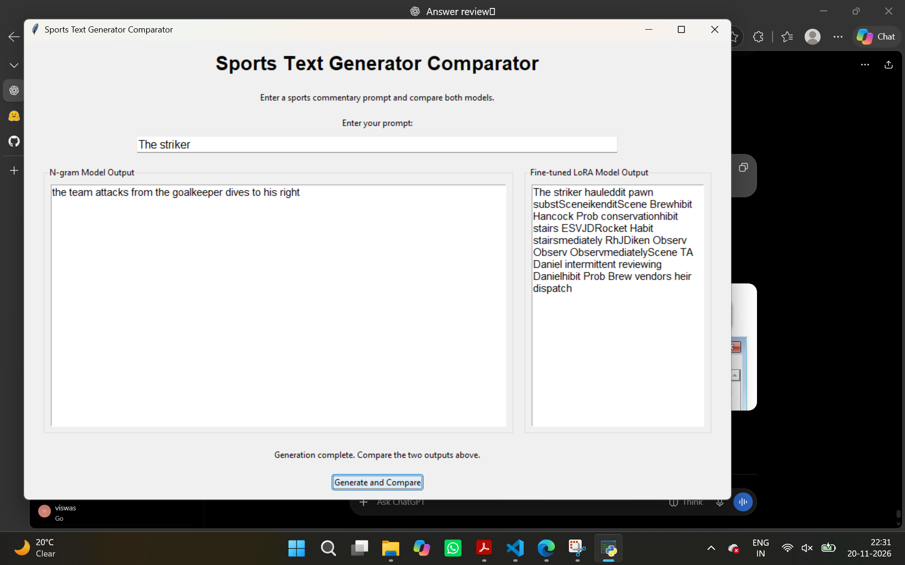
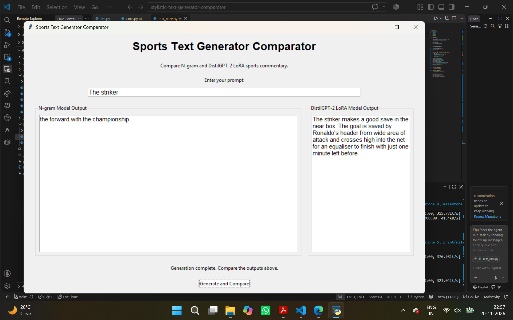

# Stylistic Text Generator Comparator

[](https://ask.thili.ai/b/gggu5y4dva)

A Python application that compares sports commentary generated by two language-generation approaches:

1. An N-gram language model.
2. DistilGPT-2 fine-tuned using Low-Rank Adaptation (LoRA).

The graphical interface lets users enter a prompt and compare generated commentary side by side.

## Project goals

- Prepare a small sports-commentary corpus.
- Implement an N-gram language model.
- Load a pretrained transformer language model.
- Implement LoRA adapter injection.
- Fine-tune the adapter on sports commentary.
- Generate text using the adapted model.
- Compare the generated outputs through a graphical interface.

## Models

| Model | Description |
|---|---|
| N-gram | Generates text using word-transition probabilities learned from the corpus |
| DistilGPT-2 + LoRA | Uses a pretrained transformer model with a fine-tuned LoRA adapter |

- **Pretrained model:** `distilbert/distilgpt2`
- **Adapter file:** `artifacts/distilgpt2_lora_adapter.pt`

## Dataset

The project uses a small, manually authored corpus of 20 sports-commentary sentences.

The corpus contains examples about goals, passing, defending, goalkeeping, match events, and team performance. It is included in the project code rather than downloaded from an external dataset provider.

This small corpus is intended for demonstrating the models and the fine-tuning workflow. It is not a large or representative sports-journalism dataset.

## Completed milestones

- [x] **1.** Prepare a small sports-commentary corpus.
- [x] **2.** Implement the N-gram model and generate text.
- [x] **3.** Load a pretrained language model and implement LoRA adapter injection.
- [x] **4.** Fine-tune the LoRA adapter on the sports-commentary corpus.
- [x] **5.** Generate text using the adapted language model.
- [x] **6.** Provide a graphical comparison interface.

## Requirements

- Python 3.12
- Git
- Internet connection for the initial pretrained-model download
- CPU or compatible hardware

Dependencies and their versions are listed in `requirements.txt`.

## Installation (Windows PowerShell)

Clone the repository:

```powershell
git clone https://github.com/kavyams2006/stylistic-text-generator-comparator.git
cd stylistic-text-generator-comparator
```

Create and activate a virtual environment:

```powershell
python -m venv .venv
.venv\Scripts\Activate.ps1
```

Install dependencies:

```powershell
python -m pip install -r requirements.txt
```

## Train the LoRA adapter

Run:

```powershell
python -c "from app.core import milestone_4; milestone_4()"
```

The trained adapter is saved to:

```text
artifacts/distilgpt2_lora_adapter.pt
```

Training can take some time, particularly on a CPU. The adapter only needs to be retrained if you want to update the weights.

## Generate sports commentary

Run:

```powershell
python -c "from app.core import milestone_5; print(milestone_5('The striker'))"
```

Replace `The striker` with another sports-related prompt to try different inputs.

## Launch the graphical interface

Run:

```powershell
python -m app.core
```

The interface allows users to enter a prompt, generate text from both models, and view the outputs side by side.

## Sample outputs

One example generated during local testing is recorded in [`results/sample_outputs.md`](results/sample_outputs.md).

The sample includes:
- N-gram output.
- DistilGPT-2 + LoRA output.

These examples demonstrate the behavior of the models; they are not a controlled benchmark.

## Evaluation

A simple sample evaluation is recorded in [`results/evaluation.md`](results/evaluation.md).

It includes word count, unique-word count, and unique-word ratio for the recorded outputs.

These statistics describe only the selected samples. They do not establish general model quality or superiority. The prompts differ, and meaningful benchmarking would require multiple controlled prompts and more evaluation measures.

## Screenshots

### Model comparison — Screenshot 1



### Model comparison — Screenshot 2



## Tests

Run the test suite:

```powershell
pytest -v
```

The project passed all 10 tests in the development environment at the time of testing.

## Project structure

```text
stylistic-text-generator-comparator/
├── app/
│   ├── core.py
│   ├── cli.py
│   ├── llm.py
│   └── storage.py
├── tests/
│   ├── test_core.py
│   └── test_smoke.py
├── artifacts/
│   └── distilgpt2_lora_adapter.pt
├── results/
│   ├── sample_outputs.md
│   └── evaluation.md
├── screenshots/
├── requirements.txt
├── README.md
├── .env.example
└── .gitignore
```

## Security

- Keep local `.env` files out of version control.
- Never commit passwords, API keys, or private credentials.
- Review files before pushing changes to GitHub.

## Future improvements

- Use a larger and more diverse sports-commentary dataset.
- Experiment with different N-gram orders.
- Improve generation quality and consistency.
- Evaluate models using multiple prompts and more robust metrics.
- Add user ratings for generated outputs.
- Experiment with other pretrained language models and LoRA configurations.

## Project development notes

The project combines a manually prepared sports-commentary corpus, an implemented N-gram model, and a LoRA adaptation workflow. The README and results folder document the implementation and example outputs so the work can be inspected and reproduced.
